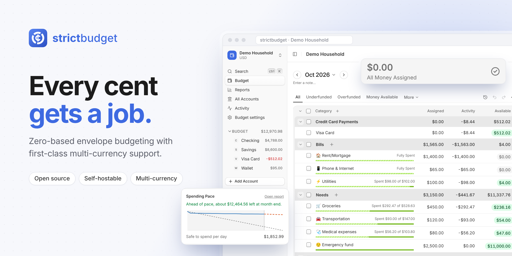
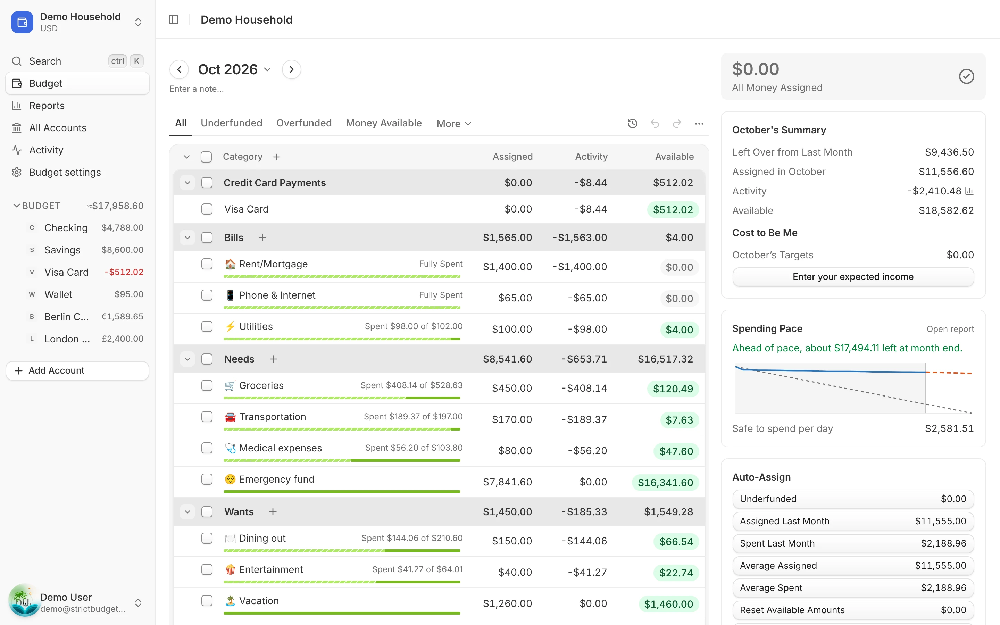
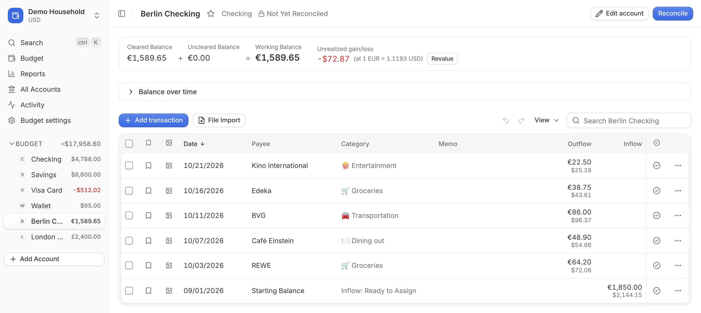
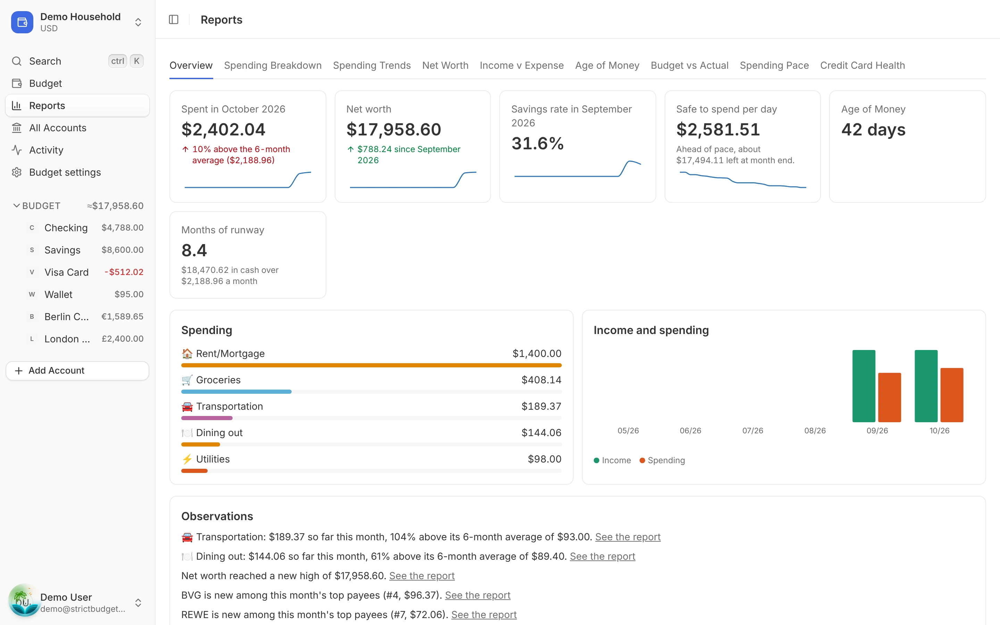

<p align="center">
  
</p>

# strictbudget

strictbudget is an open-source, self-hostable zero-based budgeting app. You give every cent a job:
money that comes in goes to Ready to Assign, you assign it to categories (envelopes), and you spend
from what each one has available. If you've used YNAB, you already know how it works.

What sets it apart is that it's yours to run, and it handles money in more than one currency
properly: each account can be in its own currency, and its activity is converted into the budget's
currency at locked-in rates.

- **The full budgeting loop**: Ready to Assign, Assigned / Activity / Available, rollover, moving
  money, overspending, Auto-Assign, undo/redo.
- **Targets**: weekly, monthly, yearly or by a date, savings balances, credit card and loan
  payments, Underfunded at a glance.
- **Accounts**: cash, checking, savings, credit cards with automatic payment categories, loans with
  interest, escrow and a payoff planner, and tracking accounts for assets and debts.
- **Transactions**: splits, transfers, scheduled transactions, flags, bulk edit, reconciliation,
  payee rules, receipt attachments, and file import (CSV, OFX, QFX, QIF) with duplicate matching.
- **Multi-currency**: around 150 currencies, daily market rates with per-budget overrides,
  cross-currency transfers, revaluation of foreign balances, and targets in a foreign currency.
- **Reports**: Spending Breakdown, Spending Trends, Net Worth, Income v Expense, Age of Money,
  Budget vs Actual, Spending Pace and Credit Card Health, with drill-down and CSV export.
- **Sharing**: invite up to 5 more people to a budget as editors or read-only viewers, with live
  updates and a change history that shows who did what.
- **Your data**: import from YNAB, export to CSV, and full JSON backups you can restore.
- **Automation**: a REST API with scoped personal API keys, and an MCP server so AI agents (Claude
  Code, Cursor, …) can work with your budget once you approve them.
- **Optional AI assistant**: ask questions about your budget, read receipts and statements, and
  propose changes you approve. Off by default; it needs an Anthropic API key on the server.

## Screenshots

<picture>
  <source media="(prefers-color-scheme: dark)" srcset="docs/screenshots/budget-dark.webp">
  
</picture>

A euro account in a US dollar budget: amounts in euros, each with its dollar value, and the
unrealized gain or loss at today's rate.



| Reports overview | Spending Breakdown |
| --- | --- |
|  |  |

## How it differs from YNAB

The budgeting method and its rules are YNAB's, so habits carry over: Ready to Assign, Available
rolling over month to month, credit card payment categories, targets and Age of Money all work the
way you expect. The differences are in who runs it and what it adds.

| | strictbudget | YNAB |
| --- | --- | --- |
| Source code | Open source (AGPL-3.0) | Closed |
| Where it runs | On your own server | YNAB's cloud only |
| Cost | Free | Subscription |
| Currencies | Every account can have its own currency; the budget converts | One currency per plan |
| Sharing | Up to 6 people per budget, with owner, editor and viewer roles | Up to 6 people, all with the same access |
| History | A change log of every edit, and who entered each transaction | Who moved money, only |
| Backups | Full JSON backup and restore, CSV export | CSV export |
| AI agents | MCP server, scoped API keys | REST API |
| Bank sync | Not yet: import bank files (CSV, OFX, QFX, QIF) | Direct Import |
| Mobile | Responsive web app, no native apps yet | iOS and Android apps |

Coming from YNAB? Use **Import** on the budgets page. It accepts a YNAB personal access token or
the files from YNAB's Export Plan.

## Self-hosting

strictbudget ships as one Docker image that serves the web app and the API from the same address
and applies database migrations when it starts. `docker-compose.prod.yml` runs it together
with PostgreSQL.

**You need** Docker with Compose, and outbound HTTPS from the server. New passwords are checked
against [Have I Been Pwned](https://haveibeenpwned.com/Passwords), and sign-up refuses while the
check can't be reached. Exchange rates are fetched daily.

### Quick start

```sh
git clone https://github.com/ikramhasan/strictbudget.git
cd strictbudget
echo "BETTER_AUTH_SECRET=$(openssl rand -base64 32)" >> .env
docker compose -f docker-compose.prod.yml up -d --build
```

Open http://localhost:3000 and create your account. Without email set up (below) there's no
confirmation step: you're signed in straight away. If you'll open it at another address (the
server's IP or hostname), set `STRICTBUDGET_URL` to that address first: signing in only works
at the address it's set to.

### Configuration

Settings go in the `.env` file next to `docker-compose.prod.yml`. Only `BETTER_AUTH_SECRET` is
required.

| Variable | Default | What it does |
| --- | --- | --- |
| `BETTER_AUTH_SECRET` | (required) | Signs sessions. At least 32 characters; keep it secret and don't change it |
| `STRICTBUDGET_URL` | `http://localhost:3000` | The address people open strictbudget at |
| `STRICTBUDGET_PORT` | `3000` | The port published on the host |
| `POSTGRES_PASSWORD` | `strictbudget` | The database password. Set it before the first start; letters and digits only |
| `RESEND_API_KEY`, `FROM_EMAIL` | (none) | Email through [Resend](https://resend.com) (see below) |
| `AI_API_KEY`, `AI_MODEL` | (none) | An Anthropic API key turns on the AI assistant. Each budget still opts in under Budget settings → AI |
| `TINYFISH_API_KEY` | (none) | A [TinyFish](https://tinyfish.ai) key lets the assistant search the web, such as to find out what an unfamiliar payee is. It is told to search for businesses only, never your amounts or accounts |
| `TRUSTED_PROXIES` or `CLIENT_IP_HEADER` | (none) | Behind a reverse proxy: its CIDRs, or the header it sets to the client's IP, so rate limits see real clients |

After changing `.env`, apply it with the same `docker compose … up -d` command.

**Email is optional.** With Resend set up, strictbudget confirms addresses, sends password reset
links and monthly summaries, and emails invitations. Without it, it sends nothing: accounts work
straight after sign-up, an email change applies at once, there's no password reset by email, and
invitations are links you share yourself.

### Putting it online

To use strictbudget away from home, put it behind a reverse proxy with HTTPS (Caddy, nginx,
Traefik, a Cloudflare Tunnel, …) and set `STRICTBUDGET_URL` to the public address, for example
`https://budget.example.com`. With the proxy on the same machine, also set
`STRICTBUDGET_PORT=127.0.0.1:3000` so only the proxy can reach the app (Docker's published ports
get past firewalls like ufw). Anyone who can open that address can create an account, so keep it
private (a VPN, or the proxy's own sign-in) if you don't want that.

### Updating

```sh
git pull
docker compose -f docker-compose.prod.yml up -d --build
```

New database migrations are applied when the container starts.

### Backups

Your data lives in two Docker volumes: `db` (PostgreSQL) and `data` (receipt attachments). To dump
the database:

```sh
docker compose -f docker-compose.prod.yml exec -T db pg_dump -U strictbudget strictbudget > strictbudget.sql
```

Each budget can also be downloaded as a JSON backup under Budget settings → Backup & data, and
restored with **Import → Restore a strictbudget backup…** on the budgets page.

### Other platforms

The image runs anywhere that can run a container: Railway, Coolify, Fly.io, Kubernetes, and so on.
Build it with `docker build -t strictbudget .`, and run `node dist/migrate.mjs` in it before each
new version starts (the compose file does this for you). It needs `DATABASE_URL` (PostgreSQL 17),
`BETTER_AUTH_SECRET`, and `BETTER_AUTH_URL` and `WEB_ORIGIN`, both set to the public address.
Attachments go to an S3-compatible bucket (`S3_*`) or a directory (`STORAGE_DIR`); with neither,
they're turned off. Every option is described in [`.env.example`](.env.example).

## Contributing

See [docs/development.md](docs/development.md) to run strictbudget from source.

## License

strictbudget is free software under the [GNU Affero General Public License v3.0 only](LICENSE)
(`AGPL-3.0-only`). You can use, change and self-host it. If you run a changed version as a service
for others, you have to offer them its source under the same licence.
